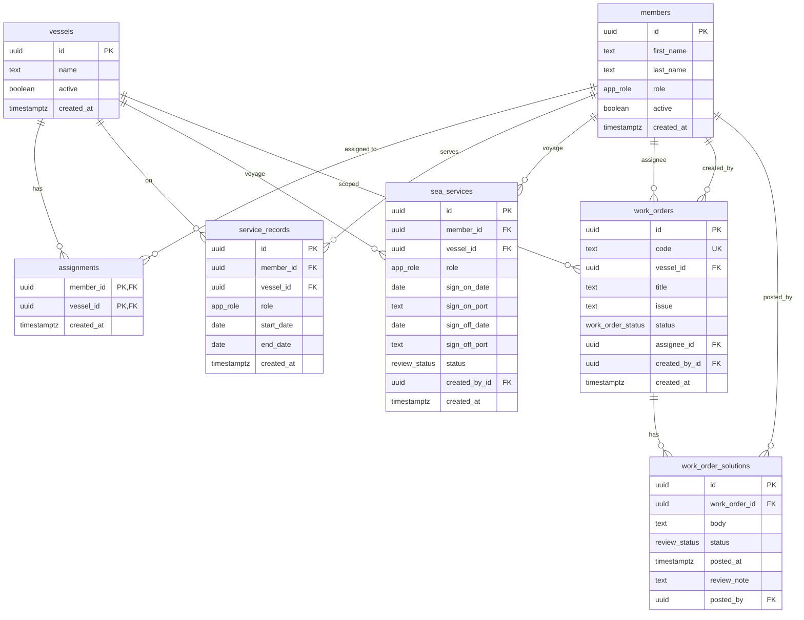

# Marine Work Order Management

Mini dashboard for vessel-scoped work orders, crew management, and multi-role operations.

Built with **Next.js** (App Router), **TypeScript**, **Tailwind / shadcn**, and **Supabase** (browser client for reads and mutations, with Postgres triggers and RLS for business rules).

## Submission

| Deliverable | Link |
| --- | --- |
| Public GitHub repository | https://github.com/jnestremos/marine-work-order-management |
| Live production URL | _Not deployed yet — add the HTTPS URL after you publish_ |
| Database schema | [`schema.sql`](./schema.sql) |
| ERD | See [Entity relationship diagram](#erd) below |

## Features

1. **Mock authentication** — sticky top bar with Vessel → Role → Member dropdowns. Selecting a member switches the session (cookie) and scopes UI + RLS headers (`x-marine-member-id`, `x-marine-role`, `x-marine-vessel-id`).
2. **Admin dashboard** — users, vessels, and vessel assignments with validation; duplicate names and unsafe deactivations are blocked in Postgres.
3. **Work order lifecycle** — captains create and assign orders (`Open`); crew document a `Solution` (status moves through `In Progress` / `Done`); captains **Attest** (approve) or **Reject** with a required rejection reason.
4. **Browser Supabase client** — `lib/supabase/client.ts` + `lib/supabase/api.ts` load and mutate data; domain rules live in migrations under `supabase/migrations/`.

## Specification checks

Automated checks for the technical assessment live in [`lib/assignment/spec.test.ts`](./lib/assignment/spec.test.ts) (mock session scoping, admin forms, work-order lifecycle, browser Supabase client, ERD / `schema.sql` deliverables).

```bash
pnpm test
```

Last local run: **71/71 tests passed** (including 23 assignment specification checks). App deployment is left to you. After you link Supabase, apply migrations with `supabase db push --linked` (includes rejection `review_note`). When the site is live, put the HTTPS URL in the Submission table above; optionally run `LIVE_URL=https://… pnpm test` to assert it.

## Getting started

```bash
pnpm install
cp .env.example .env
pnpm dev
```

Required environment variables:

```bash
NEXT_PUBLIC_SUPABASE_URL=https://YOUR_PROJECT.supabase.co
NEXT_PUBLIC_SUPABASE_PUBLISHABLE_KEY=sb_publishable_...
```

Apply database migrations to a linked Supabase project:

```bash
supabase db push --linked
```

## Scripts

```bash
pnpm test    # Vitest (includes assignment specification checks)
pnpm build   # production build
pnpm lint
```

## ERD



## Database security

- **RLS** on all public tables; access uses the mock session headers via `private.set_marine_session` (`pgrst.db_pre_request`).
- **Triggers** enforce duplicates, assignment eligibility, deactivation guards, work-order codes (`WO-1001+`), and solution review.
- The browser uses the **publishable** key only; never ship the secret key as `NEXT_PUBLIC_*`.

## Roles

| Role | Focus |
| --- | --- |
| Admin | Users, vessels, assignments, sea service history |
| Captain | Create work orders, **Attest** or **Reject** (with reason) when `Done`, view crew |
| Crew | Assigned work orders, solutions, own records |

## License

Private assessment project.
