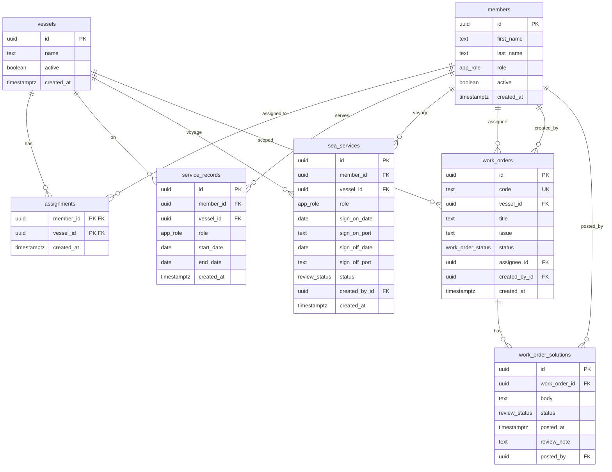

# Marine Work Order Management

Mini dashboard for vessel-scoped work orders, crew management, and multi-role operations.

Built with **Next.js 16** (App Router), **React 19**, **TypeScript**, **Tailwind CSS v4 / shadcn**, **TanStack Query**, **Zustand**, and **Supabase** (browser client for reads and mutations, with Postgres triggers and RLS for business rules). Hosted on **Vercel**.

## Tech stack (Next.js)

| Layer | Choice |
| --- | --- |
| Framework | Next.js 16 App Router (`cacheComponents`, `partialPrefetching`, Turbopack) |
| UI runtime | React 19 + TypeScript |
| Styling | Tailwind CSS v4 (`@tailwindcss/turbopack`), shadcn / Base UI, Lucide |
| Forms | react-hook-form + Zod |
| Session state | Zustand (cookie-backed mock auth) |
| Data fetching | TanStack Query — on-demand per resource, keyed by session |
| Backend access | `@supabase/supabase-js` in the browser + Postgres RLS / triggers |
| Request gating | `proxy.ts` redirects by role/path |
| Tests | Vitest |

### Server vs client components

- **Server Components:** `app/**/page.tsx` and `app/layout.tsx` are thin route shells (fonts, metadata, `export const instant = false`). They do **not** load marine data on the server.
- **Client Components:** session bar, shell, tables, forms, and page bodies (`"use client"`). Supabase reads/writes and TanStack Query run here because mock auth and `x-marine-*` RLS headers live in the browser.
- **Loading UI:** page fetches show a shared `PageContentSkeleton` via `QueryState`; session hydration / `session_choices` use the same skeleton pattern for main content.

## Submission

| Deliverable | Link |
| --- | --- |
| Public GitHub repository | https://github.com/jnestremos/marine-work-order-management |
| Live production URL | https://marine-work-order-management-theta.vercel.app |
| Database schema | [`schema.sql`](./schema.sql) |
| ERD | See [Entity relationship diagram](#erd) below |

## Features

1. **Mock authentication** — sticky top bar with Vessel → Role → Member dropdowns. Selecting a member switches the session (cookie) and scopes UI + RLS headers (`x-marine-member-id`, `x-marine-role`, `x-marine-vessel-id`).
2. **Admin dashboard** — users, vessels, and vessel assignments with validation; duplicate names and unsafe deactivations are blocked in Postgres.
3. **Work order lifecycle** — captains create and assign orders (`Open`); crew document a `Solution` (status moves through `In Progress` / `Done`); captains **Attest** (approve) or **Reject** with a required rejection reason.
4. **Browser Supabase client** — `lib/supabase/client.ts` + `lib/supabase/api.ts` load and mutate data; domain rules live in migrations under `supabase/migrations/`.
5. **On-demand React Query** — pages fetch only the resources they need (`members`, `vessels`, `assignments`, `service-records`, `sea-services`, `work-orders`); mutations invalidate matching query keys. The session bar uses a lightweight `session_choices` RPC. Loading states use skeleton placeholders in the main content area.

## Specification checks

Automated checks for the technical assessment live in [`lib/assignment/spec.test.ts`](./lib/assignment/spec.test.ts) (mock session scoping, admin forms, work-order lifecycle, browser Supabase client, ERD / `schema.sql` deliverables).

```bash
pnpm test
```

## Getting started

```bash
pnpm install
cp .env.example .env
pnpm dev
```

Required environment variables:

```bash
NEXT_PUBLIC_SUPABASE_URL=https://YOUR_PROJECT.supabase.co
NEXT_PUBLIC_SUPABASE_PUBLISHABLE_KEY=sb_publishable_...
```

Apply database migrations to a linked Supabase project:

```bash
supabase db push --linked
```

Pushes to `main` that touch `supabase/**` also run [`.github/workflows/supabase.yml`](./.github/workflows/supabase.yml) (`supabase link` + `supabase db push`). Configure repository secrets `SUPABASE_ACCESS_TOKEN`, `SUPABASE_PROJECT_ID`, and `SUPABASE_DB_PASSWORD`.

## Scripts

```bash
pnpm test    # Vitest (includes assignment specification checks)
pnpm build   # production build
pnpm lint
```

## ERD



## Database security

- **RLS** on all public tables; access uses the mock session headers via `private.set_marine_session` (`pgrst.db_pre_request`).
- **Triggers** enforce duplicates, assignment eligibility, deactivation guards, work-order codes (`WO-1001+`), and solution review.
- The browser uses the **publishable** key only; never ship the secret key as `NEXT_PUBLIC_*`.

## Roles

| Role | Focus |
| --- | --- |
| Admin | Users, vessels, assignments, sea service history |
| Captain | Create work orders, **Attest** or **Reject** (with reason) when `Done`, view crew |
| Crew | Assigned work orders, solutions, own records |

## Assumptions and decisions

The assessment leaves several areas open. Below is how those gaps were interpreted and why.

### Mock authentication (no Supabase Auth)

The brief forbids email auth and asks for three dependent dropdowns that instantly switch the active user. We treated that as a **reviewer session switcher**, not a security boundary by itself:

- Vessel → Role → Member choices live in a sticky bar and persist in a cookie so proxy/route redirects and reloads keep the same persona.
- The same values are sent on every Supabase request as `x-marine-member-id`, `x-marine-role`, and `x-marine-vessel-id`.
- Postgres loads those headers in `pgrst.db_pre_request` and RLS/triggers authorize from them.

**Assumption:** a real product would replace the dropdowns with proper Auth; the header-based session is the stand-in that still lets us prove vessel/role scoping and RLS.

### Where business rules live

The stack prefers a **browser Supabase client**. We still put domain rules in the database (triggers + RLS) rather than in React:

- Duplicate names, unsafe deactivations, assignment eligibility, work-order codes, and solution review must hold even if the UI is bypassed.
- The client validates forms for UX; Postgres remains the source of truth and returns clear errors the UI surfaces.

**Assumption:** “browser client” means reads/writes go through `supabase-js` from the browser, not that authorization logic should be client-only.

### Work order statuses vs Attest / Reject

The brief says statuses must be `Open`, `In Progress`, and `Done`, then also asks captains to **Attest** or **Reject** after `Done`. Those review outcomes need a durable state, so we modeled:

| Status | Meaning |
| --- | --- |
| `open` | Created by captain, assigned to crew |
| `in_progress` | Crew has engaged (solution path in flight) |
| `done` | Latest solution awaiting captain review |
| `accepted` | Captain attested — record fully closed |
| `rejected` | Captain rejected — crew may submit another solution |

Crew-facing labels still emphasize Open / In Progress / Done. Attest maps to `accepted` in the UI.

**Assumption:** Attest/Reject are review outcomes beyond the three operational statuses, not a replacement for them.

### Solution as history, not a single field

The brief lists `Solution` as optional until filled, and Reject must send work back with a reason. We used a **`work_order_solutions` table** so:

- every rejected attempt is kept for audit;
- at most one non-rejected solution exists at a time;
- the rejection reason is stored as `review_note` on that solution row (required when rejecting).

Submitting a solution moves the order toward review (`done` / `in_progress` per triggers). Reject clears the path for a new solution without deleting history.

### Work order identity

“Work Order ID” could mean a UUID or a human code. We store both:

- `id` — `gen_random_uuid()` primary key (never seeded as fixed fixture ids);
- `code` — `WO-1001`, `WO-1002`, … assigned by trigger for readable lists.

### Vessel scoping and admins

- Captains and crew only see work orders for vessels they are assigned to (RLS).
- Admins are **not** vessel-assigned; they may manage all vessels and directory data.
- Session dropdowns: admins appear for any vessel; captains/crew appear only when assigned to the selected vessel and active.

**Assumption:** “Admin may view and manage all vessels” means directory-wide access, not that admins are crew on every ship.

### Extra domain tables

Beyond the core work-order flow we kept **service records** (appointment history opened/closed by assignment) and **sea services** (voyage history with admin review). They support the marine directory the UI already had and reuse the same session/RLS patterns. They are not required to exercise the work-order lifecycle alone.

### Seed data

Demo data is loaded in SQL migrations with triggers paused so historical codes, dates, and a sample rejected solution remain coherent. Inserts **omit `id`** so keys come from `gen_random_uuid()`. Relationships are wired by natural keys (names / work-order codes) during seed.

### Deployment

Hosted on Vercel: https://marine-work-order-management-theta.vercel.app  
Set `NEXT_PUBLIC_SUPABASE_URL` and `NEXT_PUBLIC_SUPABASE_PUBLISHABLE_KEY` in the Vercel project environment (Production).

## License

Private assessment project.
